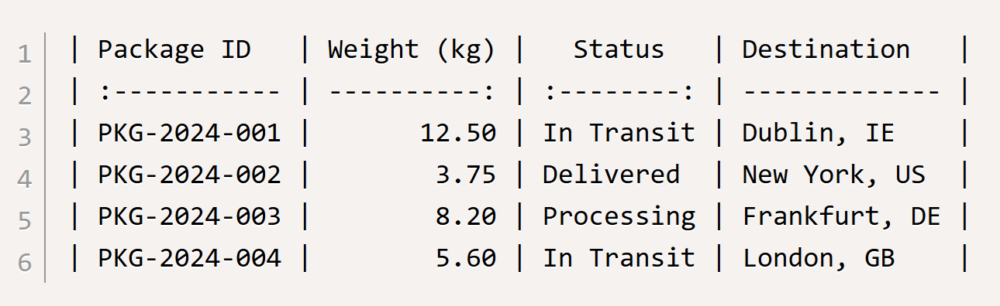
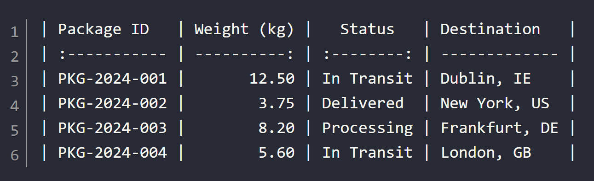

# ⚛️ react-markdown-table-ts 🛡️


[](https://www.npmjs.com/package/react-markdown-table-ts)
[](https://codecov.io/gh/keithwalsh/react-markdown-table-ts)
[](https://www.codefactor.io/repository/github/keithwalsh/react-markdown-table-ts)


|  |   |
|------------------------------------------|-----------------------------------------|
| `'light'` theme                          | `'dark'` theme                          |

## Overview 
A React component for generating and displaying formatted Markdown tables. The core component is `MarkdownTable` which converts 2D array data into properly formatted Markdown table syntax. Columns of variable width maintain consistent spacing across all rows, ensuring vertical alignment of delimiters. The output is displayed in a styled `<pre>` element with optional line numbering and supports light, dark and automatic themes, or the page's own colours. `useMarkdownTable` and `generateMarkdownTable` return the same Markdown without rendering anything.

## Installation

```bash
npm install react-markdown-table-ts
```

The component includes all necessary dependencies and its own CSS, so there is no stylesheet to import and no additional setup is required.

## API
```typescript
type CellValue = string | number | boolean | null | undefined;

interface MarkdownTableOptions {
    columnAlignments?: readonly Alignment[];
    isCompact?: boolean;
    hasPadding?: boolean;
    hasTabs?: boolean;
    hasHeader?: boolean;
    convertLineBreaks?: boolean;
}

// Also accepts the <pre> element's HTML attributes, such as id and aria-label
interface MarkdownTableProps extends MarkdownTableOptions {
    inputData?: readonly (readonly CellValue[])[] | null;
    markdown?: string;
    topPadding?: number; // Deprecated: set --rmt-padding instead
    theme?: 'light' | 'dark' | 'auto' | 'inherit';
    className?: string;
    preStyle?: React.CSSProperties;
    minWidth?: number;
    showLineNumbers?: boolean;
    nonce?: string;
    onGenerate?: (markdownTableString: string, error: MarkdownTableError | null) => void;
}

interface MarkdownTableResult {
    markdown: string;
    error: MarkdownTableError | null;
}

function useMarkdownTable(
    inputData: readonly (readonly CellValue[])[] | null | undefined,
    options?: MarkdownTableOptions
): MarkdownTableResult;

function generateMarkdownTable(
    inputData: readonly (readonly CellValue[])[],
    options?: MarkdownTableOptions
): string;

function getColumnName(index: number): string;
```
| Prop                 | Type                                    | Default     | Description                                                                        |
|----------------------|-----------------------------------------|-------------|------------------------------------------------------------------------------------|
| `inputData`          | `readonly (readonly CellValue[])[] \| null` | `null`  | The outer array represents rows. The inner array represents cells within each row. `null` renders an empty table. |
| `markdown`           | `string`                                | `undefined` | A table to show as it is, such as one from [`useMarkdownTable`](#using-the-markdown-elsewhere-on-the-page). When set, `inputData` and the formatting props are ignored. |
| `columnAlignments`   | `readonly Alignment[]`                  | `[]`	       | Acceptable values are 'left', 'center', 'right', or 'none'. Defaults to 'none' when unspecified. |
| `isCompact`          | `boolean`                               | `false`     | Disables column width alignment to provide a more compact markdown table string.   |
| `hasPadding`         | `boolean`                               | `true`      | One space added before and after the content in each cell.                         |
| `hasTabs`            | `boolean`                               | `false`     | Puts a tab on each side of the cell content, in place of the `hasPadding` space.   |
| `hasHeader`          | `boolean`                               | `true`      | Indicates whether the first row of `inputData` is a header.                             |
| `convertLineBreaks`  | `boolean`                               | `false`     | Replace newlines with <br> tags in table cells. When `false`, newlines become spaces. |
| `topPadding`         | `number`                                | `undefined` | Deprecated. Space in pixels above the first line, in place of the top of [`--rmt-padding`](#size-and-spacing). |
| `theme`              | `'light' \| 'dark' \| 'auto' \| 'inherit'` | `light` | Controls the colour scheme. `'auto'` follows the reader's `prefers-color-scheme` setting, and `'inherit'` takes the page's colours. |
| `className`          | `string`                                | `undefined` | Class will be applied to the \<pre\> element display.                                |
| `preStyle`           | `React.CSSProperties`                   | `undefined` | Allows direct styling of the display with CSS properties.                          |
| `minWidth`           | `number`                                | `undefined` | Optional minimum width in pixels for the \<pre\> element.                          |
| `showLineNumbers`    | `boolean`                               | `true`      | Show or hide line numbers in the code block.                                       |
| `nonce`              | `string`                                | `undefined` | Nonce for the component's \<style\> tag. See [Content Security Policy](#content-security-policy). |
| `onGenerate`         | `(markdownTableString: string, error: MarkdownTableError \| null) => void` | `undefined` | Called whenever the table changes. `error` is set when `inputData` is invalid. The string is empty when `inputData` is `null`. |

Other props, such as `id`, `aria-label`, `data-*` attributes and event handlers, go on the \<pre\> element, and a `ref` points to it.

## Usage Patterns

1. **Basic Table Generation**:
```typescript
<MarkdownTable
    inputData={[
        ["Header 1", "Header 2"],
        ["Row 1 Col 1", "Row 1 Col 2"]
    ]}
/>
```
2. **Column Alignment**:
```typescript
<MarkdownTable
    inputData={data}
    columnAlignments={['left', 'center', 'right']}
/>
```
3. **Auto-Generated Headers**:
```typescript
<MarkdownTable
    inputData={data}
    hasHeader={false} // Will generate A, B, C... headers
/>
```
`getColumnName(index)` returns the header for a column, counting from 0, so an editor can label its columns to match:
```typescript
import { getColumnName } from 'react-markdown-table-ts';

getColumnName(0);  // 'A'
getColumnName(26); // 'AA'
```
4. **Setting Minimum Width**:
```typescript
<MarkdownTable
    inputData={data}
    minWidth={500} // Sets the minimum width of the <pre> element to 500 pixels
/>
```
5. **Hiding Line Numbers**:
```typescript
<MarkdownTable
    inputData={data}
    showLineNumbers={false} // Hides line numbers in the code block
/>
```
6. **Following the Reader's Colour Scheme**:
```typescript
<MarkdownTable
    inputData={data}
    theme="auto" // Light or dark, matching the reader's system setting
/>
```
7. **Following the Page's Colours**:
```typescript
<MarkdownTable
    inputData={data}
    theme="inherit" // The page's text colour, with no background
/>
```
`'inherit'` suits apps with their own light and dark modes, such as Tailwind or shadcn/ui apps that switch with a `dark` class, since the table follows whatever colour the page gives it. Add a background or border with the [CSS variables](#custom-styles), such as `--rmt-background: var(--muted)`.

8. **Updating Data**:
```typescript
// A new array on every render is fine
<MarkdownTable inputData={[['Name', 'Age'], ...people.map(person => [person.name, person.age])]} />
```
The table is generated again only when a cell changes, so rows built during render don't cost a new table each time, and a cell changed in place shows the next time the component renders. Keep data you change in React state as new arrays, though: setting state to the same array, even after changing it, doesn't render the component again.

## Using the Markdown Elsewhere on the Page

`useMarkdownTable` takes the same data and options as the component and returns `{ markdown, error }`, for a copy button, a download or a preview. Pass its `markdown` to `MarkdownTable` so the table is only generated once:

```typescript
import { MarkdownTable, useMarkdownTable } from 'react-markdown-table-ts';

function CopyableTable({ data }: { data: string[][] }) {
    const { markdown, error } = useMarkdownTable(data, { columnAlignments: ['left', 'right'] });

    if (error) {
        return <p role="alert">{error.message}</p>;
    }

    return (
        <>
            <MarkdownTable markdown={markdown} />
            <button disabled={!markdown} onClick={() => navigator.clipboard.writeText(markdown)}>
                Copy as Markdown
            </button>
        </>
    );
}
```

- `markdown` is the table, or an empty string while `inputData` is `null` or `undefined`, or when it's invalid
- `error` is the `MarkdownTableError` when `inputData` or `columnAlignments` is invalid, so you can show your own error or empty state instead of the table
- Like the component, it generates the table at a lower priority than typing, so a big table can be a render behind the data
- It keeps working while the table isn't shown, such as when a preview tab replaces it

The component's `onGenerate` prop also receives the table, but only while the component is on the page.

## Generating Markdown Without Rendering

`generateMarkdownTable` takes the same data and options as the component and returns the Markdown string. It throws a `MarkdownTableError` when the input is invalid.

```typescript
import { generateMarkdownTable } from 'react-markdown-table-ts';

const markdown = generateMarkdownTable(
    [['Name', 'Age', 'Member'], ['Ann', 30, true], ['Bob', null, false]],
    { columnAlignments: ['left', 'right'] }
);
// | Name | Age | Member |
// | :--- | --: | ------ |
// | Ann  |  30 | true   |
// | Bob  |     | false  |
```

## Behaviours

1. **Input Validation**:
- `inputData` must be an array of rows, each of which is an array of cells
- `null` or `undefined` renders an empty table, for example while data loads
- Empty arrays are not allowed, and at least one row must contain a cell
- Column alignments must be valid ('left', 'center', 'right', 'none')

2. **Column Width Handling**:
- Default: Adjusts columns to fit content with 'none' alignment
- `isCompact={true}`: Minimizes column widths
- Maintains minimum width of 3 characters for alignment indicators
- Measures display width, so CJK characters and emoji count as two columns, and zero-width characters such as U+200B as none

3. **Cell Content**:
- Pipes (`|`) are escaped as `\|`; already-escaped pipes are left unchanged
- A trailing backslash is doubled so it cannot escape the closing pipe
- Tabs become spaces, since a tab's width depends on where it starts
- Non-string values are converted with `String()`; `null` and `undefined` become empty cells

4. **Error Handling**:
- Invalid `inputData` or `columnAlignments` show an error message in place of the table, and `onGenerate` receives the `MarkdownTableError`
- `useMarkdownTable` returns the `MarkdownTableError` as `error`, and an empty `markdown`
- `generateMarkdownTable` throws the `MarkdownTableError` instead
- Any other error is not caught, so it reaches the nearest error boundary

5. **Styling**:
- Includes built-in light and dark themes, an auto theme that follows the reader's colour scheme, and an inherit theme that takes the page's colours
- A table wider than its container scrolls horizontally
- Custom styles via the `className` and `preStyle` props, or the CSS variables and classes listed under [Custom Styles](#custom-styles)
- Optional line numbers for better readability

6. **Keyboard and Screen Readers**:
- A table that scrolls, because it's wider than its container or taller than a `maxHeight` set with `preStyle`, is in the tab order, so keyboard users can focus it and scroll it with the arrow keys. A table that fits isn't, since there's nothing to scroll
- Whether it scrolls is measured in the browser, so a server-rendered table joins the tab order once the page hydrates
- A `tabIndex` prop replaces this: `tabIndex={0}` keeps the table focusable, for example to focus it through a `ref`, and `tabIndex={-1}` keeps it out of the tab order
- ARIA doesn't allow `aria-label` on an element with no role, such as a \<pre\>, so not every screen reader announces it. To name a table, pass `role="region"` as well, which also lists the table among the page's landmarks

## Common Transformations

1. **Data Formatting**:
- Newlines can be converted to `<br>` tags with `convertLineBreaks`
- Padding can be controlled with `hasPadding`
- Tab spacing available with `hasTabs`

2. **Header Generation**:
- Auto-generates A, B, C... headers when `hasHeader={false}`
- Supports custom headers via first row when `hasHeader={true}`

## Custom Styles

Add your own class to the \<pre\> element with `className`, or inline styles with `preStyle`. The component's elements also have these classes, which your stylesheet can target:

| Class                                | Element                                          |
|--------------------------------------|--------------------------------------------------|
| `rmt`                                | The wrapper \<div\>                              |
| `rmt-light`, `rmt-dark`, `rmt-auto`, `rmt-inherit` | The wrapper, matching the `theme` prop |
| `rmt-pre`                            | The \<pre\> element                              |
| `rmt-has-line-numbers`               | The \<pre\> element, when line numbers show      |
| `rmt-code`                           | The \<code\> element that holds the table        |
| `rmt-line-numbers`                   | The line numbers                                 |

### Colours and Font

The colours, corners and font come from CSS variables. Set them on `:root`, on any element around the table, or on the class you pass as `className`. Your value wins over the theme's wherever you set it, whatever its selector, its place in the page or its cascade layer:

```css
:root {
  --rmt-background: #fafafa;
  --rmt-font-family: 'JetBrains Mono', monospace;
}
```

| Variable                     | Light                  | Dark                     | Inherit                    | Sets                            |
|------------------------------|------------------------|--------------------------|----------------------------|---------------------------------|
| `--rmt-background`           | `#f5f2f0`              | `#282a36`                | `transparent`              | The background                  |
| `--rmt-color`                | `#000`                 | `#f8f8f2`                | `currentColor`             | The table's text                |
| `--rmt-line-number-color`    | `#6e6e6e`              | `#999`                   | The text colour at 60%     | The line numbers                |
| `--rmt-line-number-border`   | `1px solid #999`       | `1px solid #999`         | The line number colour at 50% | The line between the line numbers and the table, as a `border` value, such as `none` |
| `--rmt-selection-background` | `#b3d4fc`              | `#44475a`                | Not used                   | The background of selected text |
| `--rmt-text-shadow`          | `0 1px #fff`           | `0 1px rgba(0,0,0,.3)`   | `none`                     | The text shadow                 |
| `--rmt-border-radius`        | `0`                    | `.3em`                   | `0`                        | The corners                     |
| `--rmt-font-family`          | `Consolas, Monaco, 'Andale Mono', 'Ubuntu Mono', monospace` | The same | The same | The font. Keep it monospace, or the columns won't line up |

A variable set this way applies in every theme. To set one for a single theme, use the theme's class, such as `.rmt-dark { --rmt-background: #1e1e1e; }`.

The inherit theme leaves selected text to the page's own `::selection` styles, so it looks like selected text anywhere else on the page. Browsers without `color-mix()`, from before 2023, show its line numbers in the text colour with no line beside them.

### Size and Spacing

These variables are the same in every theme, and are set the same way:

| Variable            | Default       | Sets                                                              |
|---------------------|---------------|-------------------------------------------------------------------|
| `--rmt-font-size`   | `1em`         | The text size                                                     |
| `--rmt-line-height` | `1.5`         | The height of each line of the table and its line numbers        |
| `--rmt-padding`     | `1em`         | The space between the edge and the table, as a `padding` value, such as `.75rem 1rem` |
| `--rmt-width`       | `fit-content` | The width. `100%` fills the container, and a wider table still scrolls |

For example, a full-width panel with smaller text, like a site's other code blocks:

```css
.markdown-table {
  --rmt-width: 100%;
  --rmt-padding: .75rem 1rem;
  --rmt-font-size: .875rem;
}
```

The space for the line numbers widens to fit them, so long tables keep their numbers clear of the line beside them.

### Other Properties

A selector like `.rmt-dark .rmt-pre` works for properties the built-in CSS doesn't set, so `.rmt-dark .rmt-pre:focus-visible { outline: 2px solid #8be9fd; }` outlines a focused dark table, and `className` can add a `border`. To change a property it does set that has no variable, such as `margin`, use `preStyle`, or a selector with three classes, such as `.rmt .rmt-pre.my-table { margin: 1em 0; }` with `className="my-table"`, since the built-in rules use selectors like `.rmt pre.rmt-pre`. Those selectors stop a page's own `pre` and `code` styles, such as Bootstrap's or Tailwind Typography's, from changing the table's layout.

None of the classes start with `language-`, so a page that runs Prism doesn't restyle the table.

## Content Security Policy

The component's CSS is in a \<style\> tag. If your Content-Security-Policy blocks inline styles, pass your page's nonce:

```typescript
<MarkdownTable inputData={data} nonce={nonce} />
```

With React 19 server rendering, React moves the \<style\> tag into the \<head\> and leaves it out unless the nonce matches the style nonce in React's render options:

```typescript
renderToPipeableStream(<App />, { nonce: { script: nonce, style: nonce } });
```

With the default props the table has no `style` attributes. `topPadding`, `minWidth` and `preStyle` each add one, which a strict `style-src` blocks in server-rendered HTML, so use `className`, the [CSS variables](#custom-styles) and your own stylesheet instead.

## Troubleshooting

### Styling Issues

If you experience styling issues when importing this component into your project (e.g., missing line numbers, incorrect colors), this may be due to CSS conflicts with other libraries or global styles in your application.

**Common Solutions:**

1. **Check for CSS conflicts**: Ensure no other libraries or global styles are overriding the component's built-in CSS.

2. **Verify theme prop**: Make sure you're using the correct `theme` prop value (`'light'`, `'dark'`, `'auto'` or `'inherit'`) for your application.

3. **Custom styling**: Set the CSS variables under [Colours and Font](#colours-and-font) and [Size and Spacing](#size-and-spacing), or use the `className` and `preStyle` props to add custom styles or override defaults as needed.

4. **Line numbers**: If line numbers aren't displaying, verify that `showLineNumbers` is set to `true` (default).

## Changelog

See [CHANGELOG.md](CHANGELOG.md) for what changed in each release.
