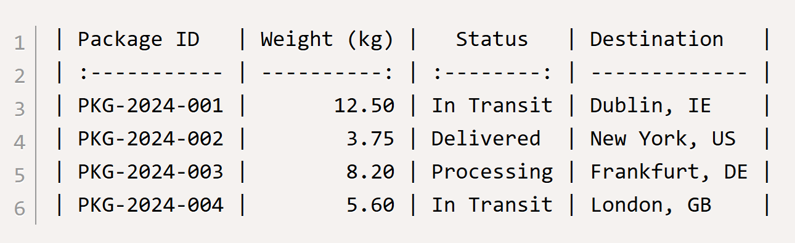
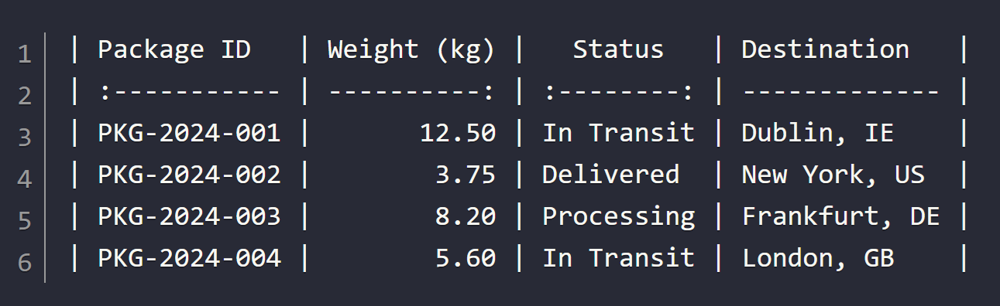

# ⚛️ react-markdown-table-ts 🛡️


[](https://www.npmjs.com/package/react-markdown-table-ts)
[](https://codecov.io/gh/keithwalsh/react-markdown-table-ts)
[](https://www.codefactor.io/repository/github/keithwalsh/react-markdown-table-ts)


|  |   |
|------------------------------------------|-----------------------------------------|
| `'light'` theme                          | `'dark'` theme                          |

## Overview 
A React component for generating and displaying formatted Markdown tables. The core component is `MarkdownTable` which converts 2D array data into properly formatted Markdown table syntax. Columns of variable width maintain consistent spacing across all rows, ensuring vertical alignment of delimiters. The output is displayed in a styled `<pre>` element with optional line numbering and supports light, dark and automatic themes. `generateMarkdownTable` returns the same Markdown without rendering anything.

## Installation

```bash
npm install react-markdown-table-ts
```

The component includes all necessary dependencies and its own CSS, so there is no stylesheet to import and no additional setup is required.

## API
```typescript
type CellValue = string | number | boolean | null | undefined;

interface MarkdownTableOptions {
    columnAlignments?: readonly Alignment[];
    isCompact?: boolean;
    hasPadding?: boolean;
    hasTabs?: boolean;
    hasHeader?: boolean;
    convertLineBreaks?: boolean;
}

// Also accepts the <pre> element's HTML attributes, such as id and aria-label
interface MarkdownTableProps extends MarkdownTableOptions {
    inputData?: readonly (readonly CellValue[])[] | null;
    topPadding?: number;
    theme?: 'light' | 'dark' | 'auto';
    className?: string;
    preStyle?: React.CSSProperties;
    minWidth?: number;
    showLineNumbers?: boolean;
    nonce?: string;
    onGenerate?: (markdownTableString: string, error: MarkdownTableError | null) => void;
}

function generateMarkdownTable(
    inputData: readonly (readonly CellValue[])[],
    options?: MarkdownTableOptions
): string;
```
| Prop                 | Type                                    | Default     | Description                                                                        |
|----------------------|-----------------------------------------|-------------|------------------------------------------------------------------------------------|
| `inputData`          | `readonly (readonly CellValue[])[] \| null` | `null`  | The outer array represents rows. The inner array represents cells within each row. `null` renders an empty table. |
| `columnAlignments`   | `readonly Alignment[]`                  | `[]`	       | Acceptable values are 'left', 'center', 'right', or 'none'. Defaults to 'none' when unspecified. |
| `isCompact`          | `boolean`                               | `false`     | Disables column width alignment to provide a more compact markdown table string.   |
| `hasPadding`         | `boolean`                               | `true`      | One space added before and after the content in each cell.                         |
| `hasTabs`            | `boolean`                               | `false`     | Puts a tab on each side of the cell content, in place of the `hasPadding` space.   |
| `hasHeader`          | `boolean`                               | `true`      | Indicates whether the first row of `inputData` is a header.                             |
| `convertLineBreaks`  | `boolean`                               | `false`     | Replace newlines with <br> tags in table cells. When `false`, newlines become spaces. |
| `topPadding`         | `number`                                | `16`        | Space in pixels above the first line, set as padding-top on the \<code\> element.  |
| `theme`              | `'light' \| 'dark' \| 'auto'`           | `light`     | Controls the colour scheme. `'auto'` follows the reader's `prefers-color-scheme` setting. |
| `className`          | `string`                                | `undefined` | Class will be applied to the \<pre\> element display.                                |
| `preStyle`           | `React.CSSProperties`                   | `undefined` | Allows direct styling of the display with CSS properties.                          |
| `minWidth`           | `number`                                | `undefined` | Optional minimum width in pixels for the \<pre\> element.                          |
| `showLineNumbers`    | `boolean`                               | `true`      | Show or hide line numbers in the code block.                                       |
| `nonce`              | `string`                                | `undefined` | Nonce for the component's \<style\> tag. See [Content Security Policy](#content-security-policy). |
| `onGenerate`         | `(markdownTableString: string, error: MarkdownTableError \| null) => void` | `undefined` | Called whenever the table changes. `error` is set when `inputData` is invalid. The string is empty when `inputData` is `null`. |

Other props, such as `id`, `aria-label`, `data-*` attributes and event handlers, go on the \<pre\> element, and a `ref` points to it.

## Usage Patterns

1. **Basic Table Generation**:
```typescript
<MarkdownTable
    inputData={[
        ["Header 1", "Header 2"],
        ["Row 1 Col 1", "Row 1 Col 2"]
    ]}
/>
```
2. **Column Alignment**:
```typescript
<MarkdownTable
    inputData={data}
    columnAlignments={['left', 'center', 'right']}
/>
```
3. **Auto-Generated Headers**:
```typescript
<MarkdownTable
    inputData={data}
    hasHeader={false} // Will generate A, B, C... headers
/>
```
4. **Setting Minimum Width**:
```typescript
<MarkdownTable
    inputData={data}
    minWidth={500} // Sets the minimum width of the <pre> element to 500 pixels
/>
```
5. **Hiding Line Numbers**:
```typescript
<MarkdownTable
    inputData={data}
    showLineNumbers={false} // Hides line numbers in the code block
/>
```
6. **Following the Reader's Colour Scheme**:
```typescript
<MarkdownTable
    inputData={data}
    theme="auto" // Light or dark, matching the reader's system setting
/>
```
7. **Updating Data**:
```typescript
// Build the rows when people changes, not on every render
const inputData = useMemo(
    () => [['Name', 'Age'], ...people.map(person => [person.name, person.age])],
    [people]
);

<MarkdownTable inputData={inputData} />
```
The table is cached on the `inputData` array itself. A new array on every render regenerates it every time, and changing the same array in place leaves the old table on screen. Memoise data you build during render, and pass a new array rather than mutating the old one.

## Generating Markdown Without Rendering

`generateMarkdownTable` takes the same data and options as the component and returns the Markdown string. It throws a `MarkdownTableError` when the input is invalid.

```typescript
import { generateMarkdownTable } from 'react-markdown-table-ts';

const markdown = generateMarkdownTable(
    [['Name', 'Age', 'Member'], ['Ann', 30, true], ['Bob', null, false]],
    { columnAlignments: ['left', 'right'] }
);
// | Name | Age | Member |
// | :--- | --: | ------ |
// | Ann  |  30 | true   |
// | Bob  |     | false  |
```

## Behaviours

1. **Input Validation**:
- `inputData` must be an array of rows, each of which is an array of cells
- `null` or `undefined` renders an empty table, for example while data loads
- Empty arrays are not allowed, and at least one row must contain a cell
- Column alignments must be valid ('left', 'center', 'right', 'none')

2. **Column Width Handling**:
- Default: Adjusts columns to fit content with 'none' alignment
- `isCompact={true}`: Minimizes column widths
- Maintains minimum width of 3 characters for alignment indicators
- Measures display width, so CJK characters and emoji count as two columns

3. **Cell Content**:
- Pipes (`|`) are escaped as `\|`; already-escaped pipes are left unchanged
- A trailing backslash is doubled so it cannot escape the closing pipe
- Non-string values are converted with `String()`; `null` and `undefined` become empty cells

4. **Error Handling**:
- Invalid `inputData` or `columnAlignments` show an error message in place of the table, and `onGenerate` receives the `MarkdownTableError`
- `generateMarkdownTable` throws the `MarkdownTableError` instead
- Any other error is not caught, so it reaches the nearest error boundary

5. **Styling**:
- Includes built-in light and dark themes, and an auto theme that follows the reader's colour scheme
- A table wider than its container scrolls horizontally, and can be focused so keyboard users can scroll it
- Custom styles via `className` and `preStyle` props
- Optional line numbers for better readability

## Common Transformations

1. **Data Formatting**:
- Newlines can be converted to `<br>` tags with `convertLineBreaks`
- Padding can be controlled with `hasPadding`
- Tab spacing available with `hasTabs`

2. **Header Generation**:
- Auto-generates A, B, C... headers when `hasHeader={false}`
- Supports custom headers via first row when `hasHeader={true}`

## Content Security Policy

The component's CSS is in a \<style\> tag. If your Content-Security-Policy blocks inline styles, pass your page's nonce:

```typescript
<MarkdownTable inputData={data} nonce={nonce} />
```

With React 19 server rendering, React moves the \<style\> tag into the \<head\> and leaves it out unless the nonce matches the style nonce in React's render options:

```typescript
renderToPipeableStream(<App />, { nonce: { script: nonce, style: nonce } });
```

With the default props the table has no `style` attributes. A `topPadding` other than 16, `minWidth` and `preStyle` each add one, which a strict `style-src` blocks in server-rendered HTML, so use `className` and your own stylesheet instead.

## Troubleshooting

### Styling Issues

If you experience styling issues when importing this component into your project (e.g., missing line numbers, incorrect colors), this may be due to CSS conflicts with other libraries or global styles in your application.

**Common Solutions:**

1. **Check for CSS conflicts**: Ensure no other libraries or global styles are overriding the component's built-in CSS.

2. **Verify theme prop**: Make sure you're using the correct `theme` prop value (`'light'`, `'dark'` or `'auto'`) for your application.

3. **Custom styling**: Use the `className` and `preStyle` props to add custom styles or override defaults as needed.

4. **Line numbers**: If line numbers aren't displaying, verify that `showLineNumbers` is set to `true` (default).
